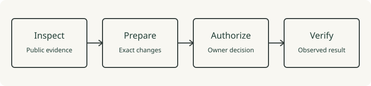

# A visible process, a readable fallback

Visual composition demo using original repository artwork. It does not depict another person's identity or career.

[GH Aura](https://github.com/ibbuilds/gh-aura) follows four steps:

1. Inspect public evidence and the owner's preferences.
2. Prepare exact changes and show their differences.
3. Execute only the plan independently authorized by the owner.
4. Verify observable results and keep unknown outcomes explicit.

The illustration adds a visual rhythm; the same information remains available as text. The [implementation](../src/profile-plan.mjs) is the proof to inspect, rather than a graphic or activity counter.
